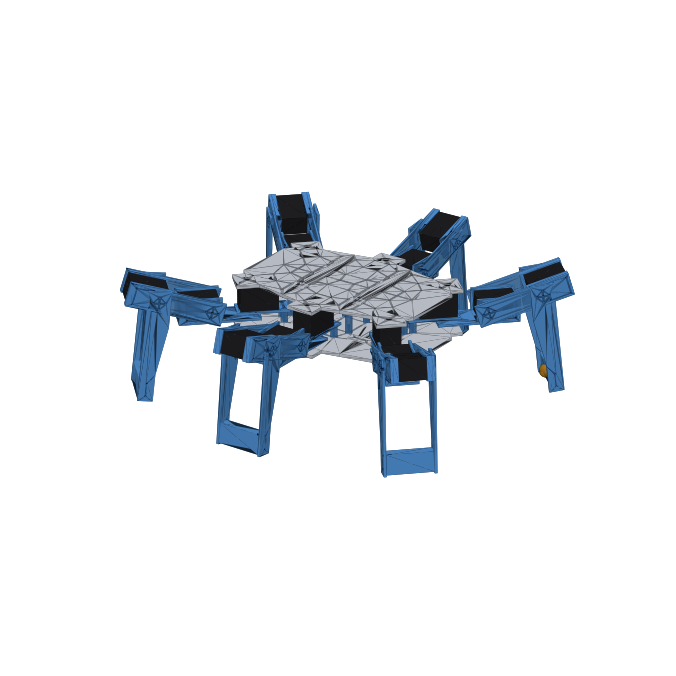

# Bemu — hexapod robot

Bemu is a six-legged walking robot built on a Raspberry Pi 5, developed in small
versions where each version adds one new capability.



**Status:** version 1 complete (2026-11-19): the full 18-joint robot walks in simulation with three gaits, turns, sidesteps and holds body-pose commands, driven through ROS 2 by `robot.launch.py`, a keyboard or a gamepad, and a torque report (`docs/reports/v1-torque-report.md`) shows the chosen servo passes the decision rule. Nothing is bought yet. Release notes: `docs/releases/v1.md`.

**Version 1.5 (printable design), written 2026-11-19, awaiting the owner's measurements and purchase approval:** the legs, body plates and coxa mounts exist as parametric CAD whose holes and pockets come from the real servo's datasheet, drawing and STEP model; the simulator and RViz show those same CAD parts with CAD masses and inertias, and the version 1 tests and torque report still pass; the parts fit a 200 × 200 mm print bed; a battery tray and a Raspberry Pi plate are in the body; neighbouring legs are checked against each other; the print order, a print quote request (English and Arabic) and a priced draft purchase list are in `cad/export/` and `docs/reports/`. Release notes: `docs/releases/v1_5.md`. To validate on the PC (WSL 2, with a Docker container): `docs/reports/v1_5-pc-validation.md`.

## The idea in five lines

1. **Simulation first.** The robot walks in a simulator before any part is bought.
2. **Programmed walking first, learned walking later.** Version 1 uses leg maths and
   gait patterns. Learned (trial-and-error) walking is a later version that replaces
   only the walking module.
3. **Modular software.** ROS 2 is the backbone, so a new sensor or behaviour is a new
   module, not a rewrite.
4. **Parametric body.** One parameter file drives the CAD, the simulation model and
   the leg maths, so resizing a leg is a one-line change.
5. **Buy in stages.** Each purchase is tied to a version and is made only after the
   previous version has passed its exit test.

## Where to start reading

| If you want to know... | Read |
|---|---|
| What this project is and is not | [docs/01-vision-and-scope.md](docs/01-vision-and-scope.md) |
| The approved design | [docs/02-design.md](docs/02-design.md) |
| What gets built in which order | [docs/03-roadmap.md](docs/03-roadmap.md) |
| What to buy, and when | [docs/10-components.md](docs/10-components.md) |
| What is still undecided | [docs/15-risks-and-open-questions.md](docs/15-risks-and-open-questions.md) |

The full index is in [docs/README.md](docs/README.md).

## Stack at a glance

| Layer | Choice |
|---|---|
| Robot's computer | Raspberry Pi 5 |
| Development PC | Windows 11, with Ubuntu 26.04 under WSL 2 |
| Operating system | Ubuntu 26.04 |
| Robot framework | ROS 2 Lyrical Luth (fallback: Jazzy on Ubuntu 24.04) |
| Simulator | MuJoCo, connected through `mujoco_ros2_control` |
| Control layer | `ros2_control` |
| First language | Python, with C++ only where ROS 2 requires it |
| Actuators (planned) | 18 smart serial-bus servos with position and load feedback |
| CAD | Parametric, code-driven (build123d), exported to STL/STEP |
| Printing | Parts are sent to a print service |

## Repository layout

```
bemu/
├── README.md            this file
└── docs/                design, roadmap, architecture, component plan
    └── decisions/       one short record per significant decision
```

Code, CAD and simulation folders are added by version 0 of the roadmap, after the
design is approved. The planned layout is in
[docs/05-software-stack.md](docs/05-software-stack.md).

## References

| Source | Used here for | Checked |
|---|---|---|
| [ROS 2 documentation](https://docs.ros.org/) | ROS 2 Lyrical Luth as the current long-term release | 2026-11-13 |
| [mujoco_ros2_control on ROS Index](https://index.ros.org/r/mujoco_ros2_control/) | The bridge between MuJoCo and ros2_control | 2026-11-13 |

The full list for the project is in [References](docs/references.md). A dash means the source
is listed for reference and was not re-read on a specific date.
