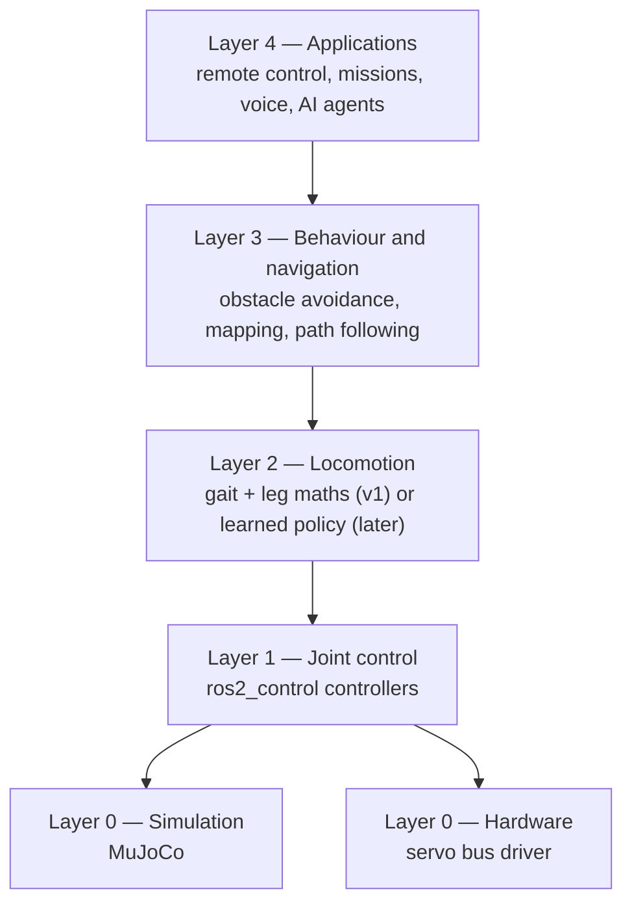
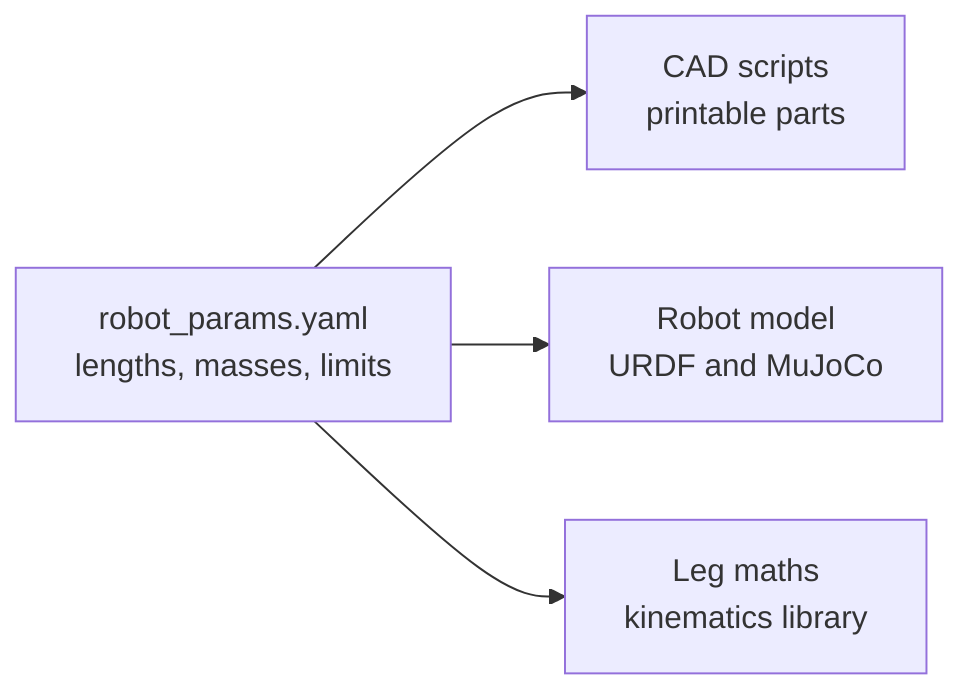

# 02 — Design

**Date:** 2026-11-13
**Status:** approved by the owner on 2026-11-14
**Size:** a project (multi-version, hardware and software)

This is the approved design. The other documents expand its sections; if they
ever disagree with this one, this one wins until it is updated.

Throughout, **Owner decision** marks something the owner said or chose.
**Proposed** marks a call made while writing this design. All proposed calls were
accepted when the owner approved the design on 2026-11-14; the label is kept to
show where each choice came from.

---

## 1. Intent

Build a six-legged walking robot on a Raspberry Pi 5 that grows one capability per
version. Begin in simulation with no hardware spending, get it standing and walking
with programmed motion, then add hardware, sensors and behaviours in stages. The
software must accept new modules without rework, and the printed body must be
changeable through parameters.

The reasoning and the success measures are in
[01 — Vision and scope](01-vision-and-scope.md).

## 2. Goals, non-goals, anti-goals

Listed in full in [01 — Vision and scope](01-vision-and-scope.md). The three that
shape the design most:

- **One code path for simulation and reality.** Everything above the motor layer is
  identical in both.
- **Modules are added, not merged in.** A new capability is a new package with a
  defined message contract.
- **Spending follows evidence.** Each purchase waits for the simulation result that
  justifies it.

## 3. Constraints

| Constraint | Source | Effect on the design |
|---|---|---|
| Raspberry Pi 5 is the robot's computer | Owner decision | All on-robot software must run on a Pi 5; heavy training runs on a PC |
| No hardware spending for now | Owner decision | Versions 0 and 1 are simulation and CAD only |
| Version 1 walks with programmed motion | Owner decision | Leg maths and gait patterns first; learning is a later module |
| Incremental versions | Owner decision | Every version has its own exit test and is usable alone |
| Scalable system | Owner decision | Message-based modular software; spare power, ports and mounting space |
| Flexible 3D parts | Owner decision | Parametric CAD driven by a parameter file |
| Documentation in Markdown in a private GitHub repository | Owner decision | This `docs/` folder |
| Plan and prioritize components before building | Owner decision | [10 — Components](10-components.md) with staged purchase gates |
| One builder | Assumed | Prefer existing, maintained tools over custom ones |
| No 3D printer; part designs are sent to someone else to print | Owner decision | Parts are designed for a print service: standard file formats, a tolerance test piece first, few and well-checked print orders |
| Development PC: Windows 11, Intel Core i9 (14900 series), 32 GB memory, NVIDIA RTX 5060 Ti with 16 GB | Owner decision | Ubuntu 26.04 runs under WSL 2 on this PC; its graphics card is available for training in version 7 |
| The robot is named Bemu | Owner decision | Packages and topics use the prefix `bemu_` |

## 4. Approaches considered

### 4.1 Software and simulator stack

Three options were laid out and the owner picked one.

| Option | What it is | Strength | Weakness |
|---|---|---|---|
| A | ROS 2 + Gazebo | The classic pairing; most tutorials; easy simulated sensors | Slow to train in; rougher leg-contact physics; weak base for learned walking |
| B | MuJoCo alone, plain Python | Fastest route to a walking simulation; best physics for legs and learning | No module system; every new sensor needs custom plumbing |
| **C** | **ROS 2 as the backbone, MuJoCo as the physics** | Module structure from ROS 2, accurate leg physics from MuJoCo; the same walking code drives the simulation and the real servos; learned walking later trains on the same model | More setup in the first week |

**Owner decision: option C.**

A fourth option, NVIDIA Isaac Lab, was dropped before the comparison: it needs a
strong NVIDIA graphics card and is far more than programmed walking requires.

Details: [decision 0002](decisions/0002-ros2-plus-mujoco.md).

### 4.2 How the robot gets its walking

| Option | What it is | Strength | Weakness |
|---|---|---|---|
| **Programmed** | Leg geometry maths plus timed stepping patterns | Works in days; every behaviour can be explained and debugged | Needs hand-tuning; does not adapt by itself |
| Learned | Trial and error in simulation, then copied to the robot | Can discover robust, adaptive walking | Needs an accurate model, feedback servos and a lot of tuning to cross from simulation to reality |

**Owner decision: programmed first, learned later.** The learned version replaces
only the walking module. Details:
[decision 0003](decisions/0003-programmed-gait-before-learning.md).

### 4.3 Order of work

| Option | What it is | Strength | Weakness |
|---|---|---|---|
| Hardware first | Buy a kit or parts, then write code | Something physical quickly | Money spent before knowing what is needed; a mistake costs a re-buy |
| **Simulation first** | Model, simulate, then buy what the simulation says | No cost until the design is tested; leg sizes and servo strength are chosen from data | The simulation must later be matched to the real robot |

**Owner decision: simulation first.** Details:
[decision 0001](decisions/0001-simulation-first.md).

## 5. The design

### 5.1 The robot

- **Six legs, three joints per leg, 18 joints in total.** The three joints are the
  hip swing (coxa), the hip lift (femur) and the knee (tibia). Three joints are the
  minimum that lets a foot be placed at any point within reach. **Proposed.**
- **Body:** an elongated hexagon, legs mounted at the corners and the middle of each
  side. Starting dimensions are in [08 — Mechanical design](08-mechanical-design.md)
  and are deliberately provisional: the simulation tunes them.
- **Target mass:** about 2.2 kg, designed with margin to 2.5 kg **(estimate)**.

### 5.2 Software structure

Five layers. Each talks only to the layer directly below it, through named ROS 2
messages.

- **Layer 0 is the only layer that differs** between simulation and the real robot.
  A launch argument chooses which one is loaded.
- **Layer 2 is replaceable.** The programmed walker and a future learned walker take
  the same inputs (a velocity command) and produce the same outputs (18 joint
  targets).
- **Sensors enter from the side** as their own modules and publish standard message
  types. Nothing above depends on which physical sensor produced the data.

Details: [04 — System architecture](04-system-architecture.md) and
[05 — Software stack](05-software-stack.md).

### 5.3 One parameter file

A single file, `robot_params.yaml`, holds every dimension, mass and limit. It feeds
three consumers:

Changing a leg length is one edit, after which the printed parts, the simulation and
the leg maths all agree. This is what makes the parts "flexible". **Proposed.**
Details: [decision 0005](decisions/0005-single-parameter-file.md).

### 5.4 Actuators

- **Smart serial-bus servos** that report position, speed, load, voltage and
  temperature back to the computer. Plain hobby servos are ruled out: with no
  feedback, the simulation cannot be matched to the robot and learned walking later
  is not realistic. **Proposed.**
- **Primary candidate:** Feetech STS3215, 12 V version (30 kg·cm stall torque).
  **Alternative:** Dynamixel X-series, with better documentation and official ROS 2
  drivers at a much higher price for the same torque.
- **The final model is not chosen yet.** The simulation in version 1 logs the torque
  each joint needs. The servo is chosen from that data at the first purchase gate.

Details: [decision 0004](decisions/0004-smart-bus-servos.md) and
[10 — Components](10-components.md).

### 5.5 Electronics

- The Pi 5 does the thinking. The servos hang off a serial bus through a small USB
  adapter. No separate microcontroller is needed at first. **Proposed.**
- One battery (3-cell lithium, about 11.1 V) powers the servos directly and the Pi
  through a 5 V step-down converter rated above the Pi 5's 5 A peak.
- A fuse, a main switch, and software limits on torque and temperature are part of
  the first hardware version, not an afterthought.
- Spare capacity is designed in: a second 5 V rail, free USB and I2C ports, and a
  mounting grid on the top deck.

Details: [09 — Electronics and power](09-electronics-and-power.md).

### 5.6 Mechanical design

- **Parametric, code-driven CAD.** Tool: build123d (Python), so the CAD is text in
  this repository, reads the parameter file directly, and can be reviewed and
  versioned like code. The owner left this choice to the designer; see
  [decision 0007](decisions/0007-code-driven-cad.md).
- **Designed to be printed by someone else.** Parts are exported in standard
  formats with a written print specification, and a tolerance test piece is
  ordered before any real part.
- **A mounting standard** for add-ons: a grid of M3 threaded inserts on a 20 mm
  pitch on the top deck, plus a front sensor mount. Any future module bolts to the
  grid without changing the body.
- **Every joint is supported on both sides**, so the servo shaft does not carry the
  bending load alone.

Details: [08 — Mechanical design](08-mechanical-design.md).

### 5.7 Versions

| Version | Adds | Spending |
|---|---|---|
| 0 | Repository, tools, parameter file, one simulated leg | None |
| 1 | Full simulated robot: stand, walk, turn, body pose | None |
| 1.5 | Printable CAD matched to the simulation; servo choice from torque data | None |
| 2 | One real leg on the bench, driven by the same code | First purchase |
| 3 | Full robot assembled: tethered, then on battery | Main purchase |
| 4 | Balance sensing: tilt sensor, body levelling, fall safety | Small |
| 5 | Touch: foot contact, stepping over uneven ground | Small |
| 6 | Perception: camera or distance sensor, obstacle avoidance | Medium |
| 7 | Learned walking as an alternative walking module | None (PC time) |
| 8+ | Autonomy and interaction: mapping, voice, AI-driven behaviours | Varies |

Each version's content and exit test: [03 — Roadmap](03-roadmap.md).

## 6. What the owner decided, in one place

1. Build incrementally, one capability per version.
2. Start with simulation and design; no hardware spending yet.
3. Version 1 uses programmed walking; learned walking comes later.
4. Software stack: ROS 2 backbone with MuJoCo physics (option C).
5. Plan first: components listed and prioritized before building.
6. The system must scale to new functionality; the 3D parts must be flexible.
7. Documentation lives in a private GitHub repository as structured Markdown.
8. The robot is named Bemu.
9. Development happens on a Windows 11 PC with an NVIDIA RTX 5060 Ti.
10. Printed parts are made by someone else from the design files.
11. The CAD tool is the designer's choice.

## 7. Calls made while writing this design

Each is **proposed** and can be changed at approval.

| # | Call | Reason |
|---|---|---|
| C1 | ROS 2 Lyrical Luth on Ubuntu 26.04; fall back to Jazzy if a needed package is missing | Lyrical is the newest long-term release, supported to May 2031, and the MuJoCo bridge lists it as supported |
| C2 | Python first; C++ only for the servo driver plugin | Fastest to write and test; ros2_control hardware plugins must be C++ |
| C3 | 18 joints, 3 per leg | The minimum for free foot placement; the common hexapod layout |
| C4 | Smart bus servos, STS3215 12 V as first candidate | Feedback is needed for simulation matching and for learning later; lowest cost per unit of torque among feedback servos checked |
| C5 | `ros2_control` as the joint layer | It is the standard seam between controllers and hardware, and the MuJoCo bridge plugs into it |
| C6 | Single parameter file feeding CAD, model and maths | Keeps the three from drifting apart |
| C7 | Code-driven CAD with build123d (choice delegated by the owner) | Parametric by nature, lives in git, reads the parameter file directly |
| C8 | Pi 5 drives the servo bus directly over USB; no microcontroller at first | Fewer parts; the bus servos have their own controllers inside |
| C9 | 3-cell lithium battery, single battery with a step-down converter for the Pi | Matches 12 V servos; one battery is simpler to charge and mount |
| C10 | Top-deck mounting grid, M3 inserts at 20 mm pitch | A fixed standard lets modules be designed without touching the body |
| C11 | Flat indoor floors only until version 5 | Keeps early versions achievable |
| C12 | Repository name `bemu`; design document at `docs/02-design.md` | Plain and findable |
| C13 | Ubuntu 26.04 under WSL 2 on the Windows PC; dual-boot Ubuntu as the fallback | Matches the Pi's operating system; no second machine needed |
| C14 | Design for a 200 × 200 mm print bed until the print service's size is known | A size almost any service can print |

## 8. Questions and answers

The four questions raised by the first draft, as answered by the owner on
2026-11-14.

| # | Question | Answer | Effect |
|---|---|---|---|
| Q1 | What is the development PC? | Windows 11, Intel Core i9 (14900 series), 32 GB memory, NVIDIA RTX 5060 Ti with 16 GB | Ubuntu 26.04 under WSL 2. The graphics card makes learned walking in version 7 trainable at home. See [13 — Development environment](13-dev-environment.md) |
| Q2 | Is there a 3D printer? | No. Designs can be sent to someone to print | Parts are designed for a print service. See [08 — Mechanical design](08-mechanical-design.md) |
| Q3 | Code-driven or visual CAD? | The designer's choice | build123d. See [decision 0007](decisions/0007-code-driven-cad.md) |
| Q4 | The robot's name? | Bemu | Package prefix `bemu_` |

One smaller question remains, and it does not block approval:

| # | Question | Needed by | Default until answered |
|---|---|---|---|
| Q5 | Which print service will be used, what is its largest part size, and which materials does it offer? | Step 1.5.6 of the roadmap | 200 × 200 mm bed; PETG or tough PLA |

## 9. What is left to the builder

Decided during implementation, within the limits above:

- Exact link lengths and body dimensions, tuned in simulation.
- Gait timing, step height and stride limits.
- Controller gains and the simulated servo model parameters.
- Print orientation, wall thickness and infill for each part.
- Internal structure of each package, as long as the message contracts in
  [05 — Software stack](05-software-stack.md) hold.
- Which community servo driver to adopt, or whether to write a thin one.

## 10. Approval

Approved by the owner on 2026-11-14, after the answers in section 8 were written
in. The next step is a written implementation plan for version 0, broken into
small tasks.

## References

| Source | Used here for | Checked |
|---|---|---|
| [ROS 2 documentation](https://docs.ros.org/) | Lyrical Luth is the newest long-term release (call C1) | 2026-11-13 |
| [ROS 2 Lyrical vs Jazzy](https://openelab.io/cs/blogs/learn/ros-2-lyrical-vs-jazzy) | Support end dates for Jazzy and Lyrical; Ubuntu pairing on the Pi 5 (call C1) | 2026-11-13 |
| [ROS 2 Lyrical installation](https://docs.ros.org/en/lyrical/Installation.html) | Supported platforms; Ubuntu packages versus the Windows archive (call C13) | 2026-11-14 |
| [mujoco_ros2_control on ROS Index](https://index.ros.org/r/mujoco_ros2_control/) | The MuJoCo bridge and the distributions it supports (section 4.1, call C5) | 2026-11-13 |
| [Introducing mujoco_ros2_control](https://discourse.openrobotics.org/t/introducing-mujoco-ros2-control-high-fidelity-simulation-for-ros-2/52683) | The bridge's release in February 2026 (section 4.1) | 2026-11-13 |
| [ros2_control documentation](https://control.ros.org/) | The joint layer shared by simulation and hardware (section 5.2) | — |
| [Feetech STS3215, Core Electronics](https://core-electronics.com.au/feetech-sts3215-smart-servo.html) | STS3215 feedback values and torque (section 5.4) | 2026-11-13 |
| [Feetech STS3215, AIFITLAB](https://aifitlab.com/collections/servo-motor/products/feetech-sts3215-servo-motor) | STS3215 12 V version: 30 kg·cm stall torque (section 5.4) | 2026-11-13 |
| [Dynamixel XL430-W250 manual](https://emanual.robotis.com/docs/en/dxl/x/xl430-w250/) | Dynamixel X-series as the alternative (section 5.4) | 2026-11-13 |
| [Powering a Raspberry Pi 5, Pololu forum](https://forum.pololu.com/t/powering-a-raspberry-pi-5/26012) | The Pi 5's 5 A supply requirement (section 5.5) | 2026-11-13 |
| [build123d documentation](https://build123d.readthedocs.io/) | The CAD tool (section 5.6) | — |
| [Installing Ubuntu 26.04 on WSL](https://www.how2shout.com/?p=89047) | Ubuntu 26.04 under WSL (question Q1) | 2026-11-14 |

The full list for the project is in [References](references.md). A dash means the source
is listed for reference and was not re-read on a specific date.
