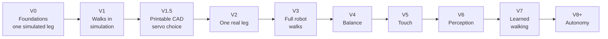

# 03 — Roadmap

Each version adds one capability, ends with a test it must pass, and leaves the
robot in a usable state. A version is finished only when its exit test passes and
the documents are updated.

Versions 0 to 1.5 cost nothing. The first purchase is at version 2.

---

## Version 0 — Foundations

**Adds:** the working environment and one simulated leg.

| Step | Content |
|---|---|
| 0.1 | Repository structure, no licence file while the repository is private, coding conventions, automated checks |
| 0.2 | Development environment: Ubuntu under WSL 2, ROS 2, MuJoCo, the MuJoCo bridge |
| 0.3 | `robot_params.yaml` with the starting dimensions |
| 0.4 | Kinematics library: forward and inverse leg maths, with tests |
| 0.5 | One-leg model in MuJoCo, driven through ros2_control |
| 0.6 | The simulated foot traces a square and a circle on command |

**Exit test**

- [x] A fresh clone builds and all tests pass with one command.
- [x] Inverse then forward kinematics returns the starting point within 0.01 mm for
      10,000 random reachable points.
- [x] Unreachable targets are rejected with a clear error, never a wrong answer.
- [x] The simulated foot follows a 60 mm square with less than 5 mm error.

**Spending:** none.

---

## Version 1 — Walks in simulation

**Adds:** the full simulated robot standing, walking and turning.

| Step | Content |
|---|---|
| 1.1 | Full 18-joint model with simple block shapes and estimated masses |
| 1.2 | Stand up and sit down sequences |
| 1.3 | Body pose control: height, shift, roll, pitch, yaw while standing |
| 1.4 | Tripod gait driven by a velocity command |
| 1.5 | Turning in place and walking sideways |
| 1.6 | Ripple and wave gaits; switching gait while moving |
| 1.7 | Keyboard and gamepad control (`bemu_teleop`) |
| 1.8 | Measurement: joint torque, speed, power, stability margin, logged per run |

Steps 1.1 to 1.3 are done (version 1a, `docs/superpowers/specs/2026-11-18-v1a-full-body-design.md`).
Steps 1.4 to 1.6 are done headless (version 1b-1, `docs/superpowers/specs/2026-11-18-v1b-walking-design.md`); the ROS walker node and launch (`robot.launch.py`, 1b-2) are written and tested headless and by ROS tests; the first run on the development PC passed (controllers active, robot stands, walks and stops). Step 1.7 (keyboard and gamepad) is `bemu_teleop`.

**Exit test**

- [x] Walks 2 m in a straight line with less than 10% sideways drift.
- [x] Turns 360° in place and ends within 50 mm of where it started.
- [x] Changes body height and tilt while walking without a foot slipping.
- [x] Switches between tripod, ripple and wave gaits without stopping.
- [x] A torque report exists: peak and average torque for every joint in every gait (`docs/reports/v1-torque-report.md`).
- [x] The whole test runs without a screen as an automated check.

**Spending:** none.

---

## Version 1.5 — Printable design and the servo decision

**Adds:** real part designs, and the data-based choice of servo.

| Step | Content |
|---|---|
| 1.5.1 | Choose the servo from the torque report (see the rule below). Evidence so far: the STS3215 12 V passes the V1 report; datasheet currents are now used |
| 1.5.2 | Parametric CAD of the leg: brackets, links, foot |
| 1.5.3 | Parametric CAD of the body: plates, electronics bay, battery bay, mounting grid |
| 1.5.4 | Replace the block shapes in the simulation with masses and inertias from CAD |
| 1.5.5 | Re-run the version 1 tests on the updated model |
| 1.5.6 | Printability review: part sizes, overhangs, split lines, fastener access. Choose the print service and confirm its build size and materials |
| 1.5.7 | Final component list with current prices and suppliers |

Progress (2026-11-19): version 1.5c (printing and buying) is written: the printability review
(`cad/export/printability.md`: every part fits a 200 × 200 mm bed, a few small supports, about 764 g of
PETG for the robot), the print order, a print quote request in English and Arabic, and a priced
draft purchase list with import notes (`docs/reports/v1_5-purchase-list.md`, decision record 0011).
What remains is the owner's: print and measure the tolerance coupon, caliper the first servo, choose a
print service from quotes, and approve the first purchase. The CAD parts also appear in the simulator
and RViz (the same meshes), with masses and inertias from the CAD.

Progress (2026-11-19): version 1.5b (CAD masses in the model, the body plates and coxa mounts) is done too:
the version 1 tests and the 48-row torque report pass on the CAD masses and the CAD body thickness.
Version 1.5a is done: the component library, verified servo hole table,
printed-leg generators with fit checks, tolerance coupon, and the first print order (not ready to
order until the coupon is measured). See `docs/08-mechanical-design.md`.

**Servo decision rule**

The chosen servo must satisfy all of these, using the torque report from the
updated model:

1. Worst-case joint torque is below 50% of the servo's stall torque.
2. Average joint torque while walking is below the servo's rated continuous torque.
3. It reports position and load back to the computer.
4. A ROS 2 driver exists, or the protocol is documented well enough to write one.

If no affordable servo passes, shorten the femur or lighten the body and re-run,
rather than buying a stronger servo first.

**Exit test**

- [x] Changing one leg length in `robot_params.yaml` regenerates the parts, the
      model and the maths with no manual editing (a longer femur is tested in `bemu_cad`).
- [x] The simulation with CAD-derived masses still passes the version 1 exit test (all version 1 tests pass; 48 of 48 torque-report rows pass; worst peak 1.26 N·m, 43% of stall).
- [ ] Every part fits the print service's build size (they fit the assumed 200 × 200 mm bed; the service is not chosen yet).
- [x] The print order is written down: files, material, settings, quantities (`cad/export/print_order.md`; it says NOT READY TO ORDER until the coupon and first servo are measured).
- [ ] The component list is priced and the first purchase is approved (priced draft: `docs/reports/v1_5-purchase-list.md`; approval is the owner's).

**Spending:** none. **Purchase gate 1** opens when this version passes.

---

## Version 2 — One real leg

**Adds:** the first hardware. Proves that simulation code drives real servos.

| Step | Content |
|---|---|
| 2.1 | Buy: 3 servos plus 1 spare, bus adapter, bench power supply, Pi accessories |
| 2.2 | Set up the Pi 5: Ubuntu, ROS 2, remote access |
| 2.3 | Servo driver as a ros2_control hardware plugin |
| 2.4 | Order a tolerance test piece, then the printed parts for one leg; assemble on a bench stand |
| 2.5 | Run the version 0 foot-tracing test on the real leg |
| 2.6 | Measure the servo: step response, speed under load, backlash, bus timing |
| 2.7 | Update the simulated servo model from the measurements |

**Exit test**

- [ ] The same launch file runs the leg in simulation or on hardware, chosen by one
      argument.
- [ ] The real foot follows the 60 mm square with less than 8 mm error.
- [ ] Simulated and real joint movement for the same command agree within 10%.
- [ ] All 3 servos are read and written at 50 times per second or faster.
- [ ] A servo that overheats or overloads is detected and the leg relaxes safely.

**Spending:** first purchase, the smallest one. **Purchase gate 2** opens when this
version passes.

---

## Version 3 — The full robot walks

**Adds:** the assembled robot, first on a tether, then on battery.

| Step | Content |
|---|---|
| 3.1 | Buy the remaining servos, battery, charger, power parts, fasteners |
| 3.2 | Order the remaining printed parts; assemble the body and six legs |
| 3.3 | Wiring, power distribution, fuse, switch |
| 3.4 | Calibration procedure: set every joint's zero position |
| 3.5 | Stand and sit on the bench power supply, robot on a stand |
| 3.6 | Walk tethered on the floor |
| 3.7 | Walk on battery; measure running time and temperature |

**Exit test**

- [ ] Passes the version 1 walking tests on a flat floor, with tolerances doubled.
- [ ] Runs 15 minutes of walking on battery with no servo above its temperature
      limit.
- [ ] Low battery triggers a warning, then a controlled sit-down.
- [ ] The power switch and the fuse have each been tested.

**Spending:** the main purchase.

---

## Version 4 — Balance

**Adds:** a tilt sensor and the behaviours that use it.

| Step | Content |
|---|---|
| 4.1 | Add an inertial sensor (IMU) and its driver |
| 4.2 | Simulate the same sensor in MuJoCo |
| 4.3 | Body levelling: keep the body flat on a tilting surface |
| 4.4 | Fall and tip-over detection with a safe shutdown |
| 4.5 | Estimate of body motion from leg positions plus the IMU |

**Exit test**

- [ ] On a board tilted to 15°, the body stays within 3° of level.
- [ ] Lifting or tipping the robot relaxes the legs within half a second.
- [ ] The levelling behaviour was developed in simulation and needed only tuning on
      the robot.

**Spending:** small (one sensor).

---

## Version 5 — Touch

**Adds:** knowing when each foot is on the ground.

| Step | Content |
|---|---|
| 5.1 | Detect foot contact from servo load readings |
| 5.2 | If load sensing is too noisy, add a switch in each foot |
| 5.3 | Terrain-adaptive stepping: a foot keeps lowering until it touches |
| 5.4 | Walking over small steps and onto a ramp |

**Exit test**

- [ ] Walks across a 20 mm step up and down without tipping.
- [ ] Walks up and down a 10° ramp.
- [ ] Contact detection is right at least 95% of the time against the simulator's
      ground truth.

**Spending:** small or none.

---

## Version 6 — Perception

**Adds:** seeing the surroundings.

| Step | Content |
|---|---|
| 6.1 | Choose the first sensor: camera, or a distance scanner |
| 6.2 | Mount on the front sensor mount or the top grid |
| 6.3 | Simulated version of the same sensor |
| 6.4 | Stop before obstacles; steer around them |
| 6.5 | Optional: build a map and move to a chosen point |

**Exit test**

- [ ] Stops before a wall from any approach angle.
- [ ] Crosses a room with three obstacles without touching them.
- [ ] The walking code was not edited to add this version.

**Spending:** medium (camera or scanner).

---

## Version 7 — Learned walking

**Adds:** a second walking module, trained by trial and error in simulation.

| Step | Content |
|---|---|
| 7.1 | Training environment built on the existing MuJoCo model |
| 7.2 | Train a walking policy; compare with the programmed walker in simulation |
| 7.3 | Randomize the simulation so the policy tolerates real-world differences |
| 7.4 | Run the policy on the Pi 5 as a drop-in replacement for the programmed walker |
| 7.5 | Compare both on the real robot: speed, energy use, stability |

**Exit test**

- [ ] The learned walker is selected by a launch argument; nothing else changes.
- [ ] It walks on the real robot without modification after training.
- [ ] A written comparison of the two walkers exists.

**Spending:** none. Training runs on the development PC's graphics card.
See [11 — Learning roadmap](11-learning-roadmap.md).

---

## Version 8 and beyond — Autonomy and interaction

Candidates, in no fixed order. Each becomes its own version when chosen.

- Mapping and autonomous navigation between rooms.
- Voice commands and spoken replies.
- Behaviours directed by an AI agent: describe a goal in words, the robot plans steps.
- Object or person following.
- A small arm or gripper on the top grid.
- Self-docking and charging.
- Rough-terrain walking outdoors.

---

## Rules that apply to every version

1. **Simulation before hardware.** A capability is developed and tested in
   simulation first, then moved to the robot.
2. **The exit test is written before the work starts** and is not loosened to pass.
3. **A version does not edit lower layers** unless a decision record explains why.
4. **Every version ends with a tag** (`v0`, `v1`, ...) and a documentation pass.
5. **Purchases happen at gates**, never ahead of them.

## References

No external sources. This document draws only on the owner's decisions and the
other documents in this repository. The project's full list is in
[References](references.md).
