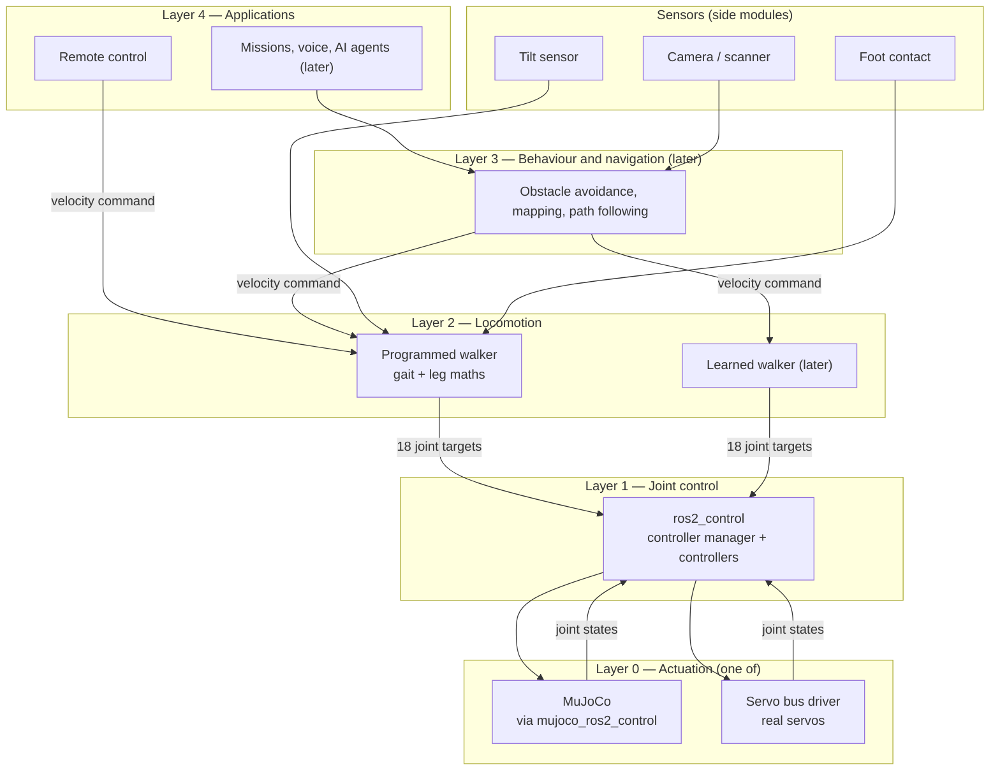
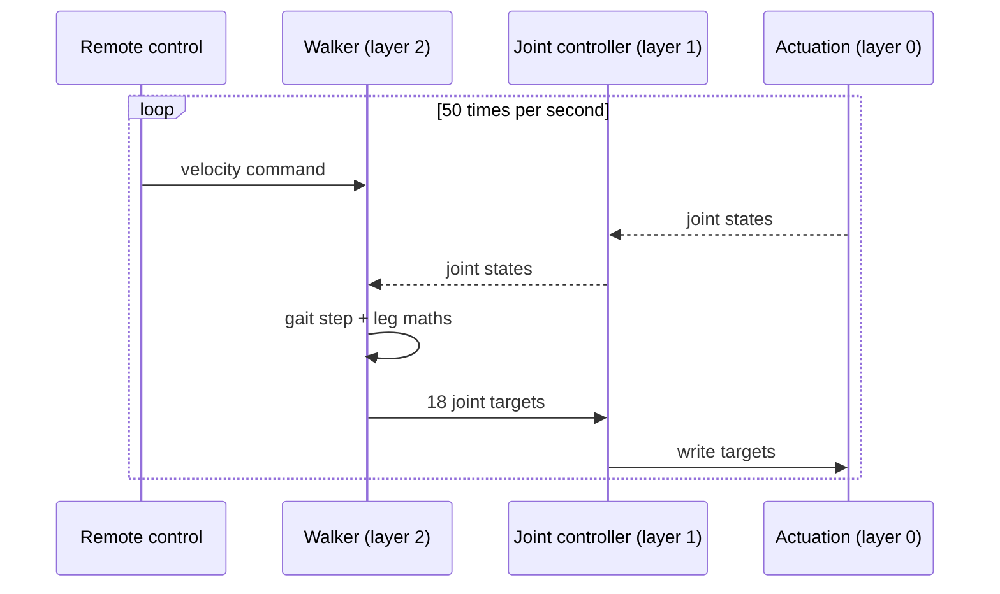

# 04 — System architecture

How the software is divided, and how one code path serves both the simulator and
the real robot.

## The five layers

| Layer | Job | Knows about | Does not know about |
|---|---|---|---|
| 4 Applications | Decide what the robot should do | Goals, user input | Legs, joints, servos |
| 3 Behaviour | Turn a goal into a direction and speed | The surroundings, the map | How walking works |
| 2 Locomotion | Turn direction and speed into joint angles | Leg geometry, gait timing, balance | Which motors or simulator execute it |
| 1 Joint control | Deliver joint targets and report joint states | Joint names, limits, rates | Why the joints are moving |
| 0 Actuation | Move the joints | The physics engine or the servo protocol | Everything above |

## The rule that makes it scale

**A layer talks only to the layer directly below it, and only through a named
message contract.** Contracts are listed in
[05 — Software stack](05-software-stack.md).

Three consequences:

1. **Swapping the simulator for the robot changes one layer.** Layers 1 to 4 run
   unmodified.
2. **Swapping the walker changes one module.** The programmed walker and a learned
   walker accept the same command and produce the same output.
3. **Adding a sensor adds a module.** It publishes a standard message type. Modules
   that want the data subscribe; modules that do not are untouched.

## Simulation and reality: the seam

The seam is `ros2_control`. It defines a *hardware interface*: a small component
that accepts joint commands and returns joint states. Two implementations exist:

| | Simulation | Real robot |
|---|---|---|
| Hardware interface | Supplied by `mujoco_ros2_control` | Servo bus driver (version 2) |
| Joint command | Target angle, in radians | Target angle, in radians |
| Joint state | Angle, speed, effort from the physics engine | Angle, speed, load from the servo |
| Clock | Simulated time | Real time |
| Chosen by | `use_sim:=true` | `use_sim:=false` |

Everything above sees identical joint names, units and topics in both cases.

## Timing

| Loop | Rate | Notes |
|---|---|---|
| Physics step in MuJoCo | 500 per second | 2 ms step |
| Joint control and servo bus | 50 to 100 per second | Limited by the bus round-trip for 18 servos; measured in version 2 |
| Walker | 50 per second | One gait update per control cycle |
| Tilt sensor | 100 per second | When added |
| Camera, scanner | 10 to 30 per second | When added |
| Behaviour | 5 to 10 per second | When added |

All modules read the ROS clock, never the system clock directly, so the same code
runs correctly on simulated time.

## What runs where

| Machine | Runs |
|---|---|
| Development PC | Simulation, visualisation, CAD, tests, training (later) |
| Raspberry Pi 5 | Layers 0 to 3 on the real robot; later, the learned policy |
| Either | Remote control and applications, over the network |

ROS 2 nodes on the PC and the Pi discover each other on the same network, so the
visualiser on the PC can show the real robot's state with no extra code.

## Safety sits at the bottom

Protections live in the lowest layer that can enforce them, so no bug above can
bypass them.

| Protection | Layer | Behaviour |
|---|---|---|
| Joint angle limits | 0 and 1 | Targets outside the limits are clamped |
| Torque and temperature limits | 0 | The servo's own protection, plus a driver check that relaxes the leg |
| Command timeout | 2 | No velocity command for 0.5 s means stop walking and hold |
| Low battery | 0 → 2 | Warning, then a controlled sit-down |
| Tip-over | 2 | Relax the legs (version 4) |
| Fuse and main switch | Electrical | Independent of all software |

## Growth path

| Version | Architecture change |
|---|---|
| 0–1 | Layers 0 (simulation), 1, 2 and remote control |
| 2–3 | Second layer-0 implementation: the servo driver |
| 4 | Tilt sensor module; levelling added inside layer 2 |
| 5 | Foot contact module; adaptive stepping inside layer 2 |
| 6 | Layer 3 appears: obstacle avoidance, optional mapping |
| 7 | Second layer-2 implementation: the learned walker |
| 8+ | Layer 4 grows: missions, voice, AI agents |

No version requires restructuring what came before. That is the test of the
architecture.
