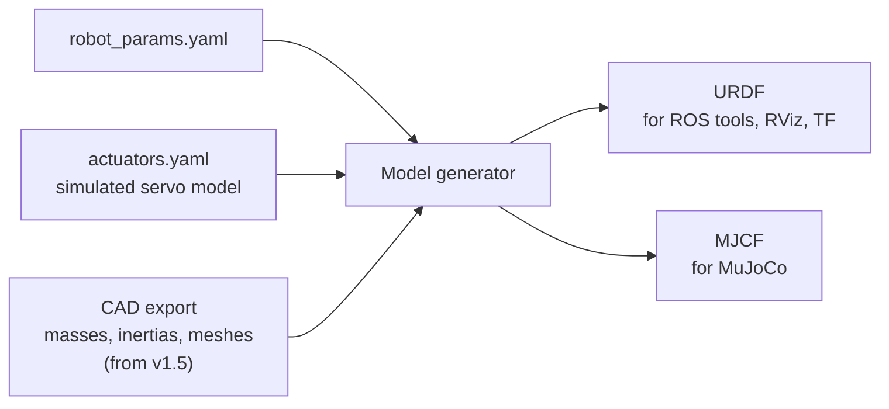

# 06 — Simulation

The simulator is where versions 0 and 1 live entirely, and where every later
capability is developed before it touches the robot.

## What the simulation is for

1. **Develop walking with no hardware.** Versions 0 and 1.
2. **Choose the hardware from data.** The torque report decides the servo.
3. **Test safely.** A fall in simulation costs nothing.
4. **Regression tests.** Every change is checked by an automated simulated walk.
5. **Training ground.** Learned walking in version 7 trains on the same model.

## Pieces

| Piece | Role |
|---|---|
| MuJoCo | Physics: bodies, joints, contacts, simulated servos and sensors |
| `mujoco_ros2_control` | Presents the MuJoCo model to ROS 2 as a ros2_control hardware interface |
| Robot model | The description of the robot, generated from `robot_params.yaml` |
| Scene | Floor, lighting, and later ramps, steps and obstacles |

## One model, generated

Nothing in the robot model is typed by hand. A generator script reads the parameter
file and writes the model.



- **URDF** is the format ROS tools read. **MJCF** is MuJoCo's own format.
- The MuJoCo bridge includes utilities that produce a MuJoCo model from a URDF.
  Step 0.5 of the roadmap tries that path first. If it cannot express something the
  model needs, the generator writes both formats directly from the parameter file.
  Either way, the parameter file stays the only source.
- Until version 1.5 the links are simple boxes and cylinders with estimated masses.
  From version 1.5 the masses, inertias and shapes come from the CAD.

## Modelling choices

| Aspect | Choice | Reason |
|---|---|---|
| Time step | 2 ms | Stable for stiff position-controlled joints with ground contact |
| Control rate | 50 per second | Matches what the real servo bus is expected to deliver |
| Joints | 18 hinge joints with angle limits | Mirrors the real robot |
| Actuators | Position-controlled, with torque limits | Mirrors a servo: it is told an angle and pushes toward it |
| Feet | Small spheres with rubber-like friction | Point contact is stable and close to a rounded rubber foot |
| Floor | Flat plane first; ramps, steps and rough patches from version 5 | Matches the roadmap |
| Self-collision | Enabled between legs and body, disabled between adjacent links | Catches leg crossing without false contacts at the joints |

## The simulated servo

A real servo is given a target angle and drives toward it with limited torque and
limited speed. The simulated one is modelled the same way:

```
torque = kp × (target angle − angle) − kv × speed
torque is limited to ± max torque
```

| Parameter | Meaning | Starting value | Final value comes from |
|---|---|---|---|
| `kp` | Stiffness: how hard it pushes per radian of error | 20 N·m/rad (placeholder) | Step-response measurement, version 2 |
| `kv` | Damping | 0.5 N·m·s/rad (placeholder) | Step-response measurement, version 2 |
| Max torque | Torque limit | 50% of the candidate servo's stall torque | Servo datasheet, then measurement |
| Max speed | No-load speed | From the datasheet (about 4.7 rad/s for the 12 V STS3215) | Measurement, version 2 |
| Joint friction and rotor inertia | Gearbox drag and reflected motor inertia | Small placeholder values | Measurement, version 2 |
| Delay | Time between command and motion | 1 control cycle | Bus timing measurement, version 2 |

The placeholders are good enough to develop walking. They are not good enough to
trust torque numbers to the last 10%, which is why the servo decision rule in the
[roadmap](03-roadmap.md) keeps a factor-of-two margin.

## Simulated sensors

Each real sensor gets a simulated twin that publishes the same message type on the
same topic. Modules that consume sensor data cannot tell the difference.

| Sensor | Added in | MuJoCo source | Published as |
|---|---|---|---|
| Joint angles and efforts | 0 | Joint and actuator readings | `/joint_states` |
| Tilt sensor | 4 | Orientation, gyro and accelerometer at `imu_link` | `/imu/data` |
| Foot contact | 5 | Touch sensor at each foot | `/foot_contacts` |
| Distance scanner | 6 | Ray casting | `sensor_msgs/LaserScan` |
| Camera | 6 | Rendered image | `sensor_msgs/Image` |

Simulated sensors start ideal. Noise and delay are added once the real sensor has
been measured.

## The torque report

Produced at the end of version 1 and again in version 1.5. It is the evidence for
the first purchase.

For each gait, at slow, medium and maximum speed, with body mass at 2.0, 2.2 and
2.5 kg:

| Measured | Why |
|---|---|
| Peak torque per joint | Must stay under 50% of stall torque |
| Average (root-mean-square) torque per joint | Must stay under rated continuous torque; predicts heating |
| Peak joint speed | Must stay under the servo's loaded speed |
| Electrical power estimate | Sizes the battery and wiring |
| Stability margin | How close the robot came to tipping |
| Foot slip | Checks friction assumptions |

The report is generated by a script and saved with the version tag.

## Keeping the simulation honest

A simulation that drifts from reality is the main risk of this plan. The defences:

| When | Check |
|---|---|
| Version 1.5 | Masses and inertias come from CAD, not guesses |
| Version 2 | One real leg: measure step response, speed, backlash; fit the servo model |
| Version 2 | Same foot path, simulated and real, compared on one plot |
| Version 3 | Weigh the finished robot; correct the model |
| Version 3 | Same walk, simulated and real: compare speed, drift, power |
| Every version | Any behaviour tuned on the robot is re-run in simulation; a difference is a model bug to fix |

## Running without a screen

The simulator can run with no window. The automated checks use this mode to run the
exit tests of every completed version on every change. See
[14 — Testing and validation](14-testing-and-validation.md).

## Later: training

Version 7 reuses the MuJoCo model for learning. Training wants thousands of copies
of the robot running at once, which uses a different MuJoCo runtime than the single
robot connected to ROS. The model file is shared; only the way it is run changes.
See [11 — Learning roadmap](11-learning-roadmap.md).
