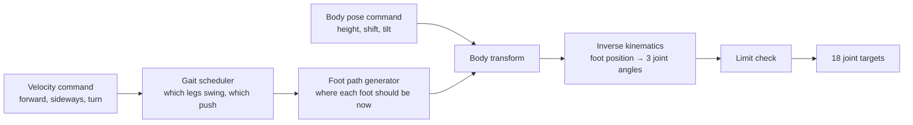

# 07 — Locomotion

How the robot stands, walks and keeps its balance with programmed motion. This is
the walker in layer 2 of the [architecture](04-system-architecture.md).

## Why a hexapod does not need to learn balance

With six legs, the robot can always keep three feet on the ground in a triangle. As
long as its centre of mass stays above that triangle, it cannot fall. This is called
static stability. Walking becomes a geometry problem: decide where each foot should
be, then work out the joint angles that put it there.

## The pipeline



Each stage is a pure function with tests. The node around them only handles
messages and timing.

---

## 1. Leg geometry

Each leg has three joints and three segments.

| Symbol | Segment | Starting length |
|---|---|---|
| `Lc` | Coxa: hip swing axis to hip lift axis | 45 mm |
| `Lf` | Femur: hip lift axis to knee | 65 mm |
| `Lt` | Tibia: knee to foot tip | 110 mm |

These are starting values, tuned in simulation.

### Leg frame

Origin on the hip swing axis. **x** points straight out from the body along the
leg's resting direction, **y** is to the left of that when seen from above, **z**
is up. A foot on the ground has negative z.

### Joint angles

| Angle | Joint | Zero position | Positive direction |
|---|---|---|---|
| `θc` | Coxa | Leg pointing straight out | Counter-clockwise from above |
| `θf` | Femur | Femur horizontal | Femur raised |
| `θt` | Tibia | Tibia in line with femur | Tibia raised (so a bent knee is negative) |

### Forward kinematics: angles to foot position

```
r = Lf·cos(θf) + Lt·cos(θf + θt)        horizontal reach beyond the hip lift axis
z = Lf·sin(θf) + Lt·sin(θf + θt)
x = (Lc + r)·cos(θc)
y = (Lc + r)·sin(θc)
```

### Inverse kinematics: foot position to angles

Given a foot target `(x, y, z)` in the leg frame:

```
θc = atan2(y, x)
r  = sqrt(x² + y²) − Lc
d  = sqrt(r² + z²)                       straight-line distance, hip lift axis to foot

reachable only if  |Lf − Lt| ≤ d ≤ Lf + Lt

α  = atan2(z, r)
β  = acos( (Lf² + d² − Lt²) / (2·Lf·d) )
γ  = acos( (Lf² + Lt² − d²) / (2·Lf·Lt) )

θf = α + β
θt = γ − π
```

This picks the knee-up solution, the natural stance for a hexapod.

**Worked check.** Target: femur horizontal, tibia straight down, so `r = Lf`,
`z = −Lt`. Then `d = sqrt(Lf² + Lt²)`, `α = −atan(Lt/Lf)`, `β = +atan(Lt/Lf)`, so
`θf = 0`. And `γ = 90°`, so `θt = −90°`. Correct.

### Handling impossible targets

| Situation | Response |
|---|---|
| Target too far (`d > Lf + Lt`) | Report "unreachable"; the walker shortens the stride |
| Target too close (`d < |Lf − Lt|`) | Report "unreachable" |
| Target behind the hip axis (`r ≤ 0`) | Report "unreachable" |
| Angle outside joint limits | Report "limit"; the walker reduces the motion |
| Argument of `acos` slightly outside −1…1 from rounding | Clamp, do not fail |

The kinematics library never returns a silently wrong answer.

### Neutral stance

The resting foot position, per leg, in the leg frame:

| Value | Starting choice | Resulting angles |
|---|---|---|
| Foot distance from hip swing axis | 120 mm | |
| Foot height below hip axes | 90 mm | |
| Coxa | | 0° |
| Femur | | about +17° |
| Tibia | | about −100° |

The femur is slightly raised and the tibia is close to vertical. This keeps the
foot only 75 mm out from the hip lift axis, which is what sets the femur servo's
torque.

---

## 2. From body to legs

Each leg is mounted at a known position and angle on the body. To go from a foot
position in the body frame `P` to the leg frame `p`:

```
p = Rz(−ψ) · (P − m)
```

where `m` is the leg's mounting point and `ψ` its mounting angle. Mounting values
are in [08 — Mechanical design](08-mechanical-design.md).

### Body pose

In the code (`bemu_kinematics.body`) the planted foot is the foot sphere's *centre*, 8 mm above
the floor, and heights are the hip plane's height above the floor: **98 mm** standing (the
stance's 90 mm above the foot centres, plus the 8 mm) and **28 mm** sitting (half the 56 mm
body). The sit pose is the tight one: the femur needs 85.6° of its 90° limit, and the
parameter loader rejects a body too thin (under 48 mm) to sit.

To raise, shift or tilt the body while the feet stay planted: if the body should
move by translation `t` and rotation `R` from neutral, each planted foot, seen from
the body, moves the opposite way:

```
P_new = Rᵀ · (P_neutral − t)
```

Feeding `P_new` through the leg transform and inverse kinematics gives the joint
angles. The same formula produces body height changes, leaning, twisting and the
stand-up sequence.

---

## 3. Gaits

A gait is a timing pattern: when each leg is on the ground pushing (**stance**) and
when it is in the air moving forward (**swing**).

Two numbers describe it:

- **Cycle time `T`:** the time for one full step cycle.
- **Duty factor:** the fraction of the cycle a leg spends in stance.

Each leg has a **phase offset**, its position in the cycle relative to the others.
A leg's phase is `(time / T + offset) mod 1`. It is in stance while its phase is
below the duty factor.

| Gait | Duty factor | Feet down | Phase offsets (LF, LM, LR, RF, RM, RR) | Character |
|---|---|---|---|---|
| Tripod | 1/2 | 3 | 0, 1/2, 0, 1/2, 0, 1/2 | Fastest. Two triangles alternate |
| Ripple | 2/3 | 4 | 0, 1/3, 2/3, 2/3, 1/3, 0 | Smoother; legs move in three pairs |
| Wave | 5/6 | 5 | 1/2, 2/3, 5/6, 0, 1/6, 1/3 | Slowest and most stable; one leg at a time, rear to front on the left side, then on the right |

The offsets are starting values. They are checked in simulation for stability
margin and adjusted if a pairing puts the centre of mass too close to an edge.

Tripod is the default and the first implemented.

---

### Neighbouring legs (from the CAD, version 1.5d)

The printed legs collide if two neighbours swing toward each other too far. With both legs in the
same femur and knee pose, two neighbours are collision-free while the two coxa angles toward each
other sum to 45° or less and collide at 60° (`bemu_cad`, `test_body.py`). The gaits at top speed reach
about 43° (wave) and `bemu_cad/test/test_neighbours.py` fails if a gait goes over 45°. The coxa limit
itself stays ±45° because body shifts and yaw move all legs the same way. Nothing in the walker
enforces the rule at run time; it is a design check.

## 4. Foot paths

All positions here are in the body frame.

### Stance: the foot pushes

While a foot is on the ground and the body moves, the foot moves backward relative
to the body. For a commanded body velocity `v` and turn rate `ω`, the stride for a
leg whose neutral foot position is `r_i` is:

```
stride_i = (v + ω × r_i) · T_stance          where T_stance = duty factor × T
```

During stance the foot moves in a straight line from `r_i + stride_i / 2` to
`r_i − stride_i / 2`.

The `ω × r_i` term is what makes turning work: each foot's stride is tangent to a
circle around the body centre, so the same formula covers straight walking,
sideways walking, turning in place and any mix.

### Swing: the foot returns

During swing the foot travels from the end of its stride back to the start, lifted
off the ground:

```
u = progress through swing, 0 → 1
horizontal position: smooth blend from end point to start point
height above ground: step_height · sin(π · u)
```

The blend starts and ends gently so the foot does not jerk at lift-off or slam at
touchdown. A later refinement matches the foot's ground speed to zero at the moment
of touchdown.

### Starting parameters

| Parameter | Starting value |
|---|---|
| Cycle time (tripod) | 1.0 s |
| Step height | 20 mm (30 mm in the first draft; see below) |
| Maximum stride | 60 mm |
| Body height | 90 mm |
| Resulting top speed (tripod) | 60 mm ÷ 0.5 s = 0.12 m/s |
| Cycle time, ripple / wave | 1.5 s / 3.0 s: every gait swings for 0.5 s |
| Top speed, ripple / wave | 60 mm ÷ 1.0 s = 0.06 m/s / 60 mm ÷ 2.5 s = 0.024 m/s |

These are the values in `bemu_gait/config/gait.yaml`, tuned against the simulator
(version 1b-1). **Swing speed sets the torque:** the largest torque
on any 2 ms physics step grows with how fast a foot is lifted and lowered. With a 30 mm step
the tripod needed 1.24 to 1.45 N·m at 0.1 m/s (the limit is 1.47); with 20 mm, 0.88 to 0.98.
A 0.6 s wave cycle swung a foot in 0.1 s and saturated the servo model, so every gait now
swings for the tripod's 0.5 s, which also makes the wave the slowest, as it should be.
**Planted-foot slip is the walker's job to keep small, and it is:** with foot positions
integrated (see below), loaded slip is 3.7 to 4.4 mm for the tripod, ripple and wave at forward
speeds up to their tops, and for turning in place. The one exception is the tripod walking
sideways: 5.0 mm at 0.08 m/s and 5.9 mm at its 0.12 m/s top speed.

### How the feet move

Phases decide *when* a leg is in stance or swing. Foot *positions* are state. In stance a
foot moves in the body frame at exactly the speed the ground moves under the body,
`−(v + ω × r)`, a rigid motion about the body centre, so a planted foot does not slip
whatever the command or the gait does. In swing the foot goes from where it lifted off to the
point where the stance will begin (`+stride/2`), along the smooth blend. The closed form
`stride × (0.5 − u)` in the section above is the steady-state path. As the walker's whole
definition it dragged planted feet whenever the speed or the duty factor changed (20.9 mm for
the wave at start-up), which is why positions are integrated.

### Starting and stopping

The commanded velocity is clamped to what the 60 mm stride cap allows, then slewed
(0.05 m/s², 1 rad/s²), so a command above top speed cannot wind up and stopping always takes
top speed ÷ acceleration (2.4 s for the tripod). The step height is scaled by the stride (full
at 30 mm of stride), so at zero command the feet stand at their neutral points and do not
lift; there is no special "stopped" state. At the very start the tripod legs that begin in
swing scrape the floor for about a second (up to 9 mm) while the lift is still rising.

### Gait switching

A gait change keeps every leg's phase and slides its phase offset (the short way round the
circle), the duty factor and the cycle time linearly to the new gait's values over two cycles
of the old gait. Foot position depends smoothly on phase and duty, so no foot jumps. Part-way
through a blend the legs on the ground can form a triangle that does not contain the centre
of mass (a margin of −4 mm was seen about a second into tripod to ripple). The stability
reaction below lowers the lifts, but cannot prevent that moment, the body is knocked, and
**planted feet slip while a gait is changing**: 3.6 to 25 mm at 0.9× the pair's top speed
(worst: ripple to tripod 25 mm, tripod to ripple 18 mm), and 4 mm or less once the blend is
done. The exit criteria still hold (margin 82 to 92 mm, tilt under 1°, torque at most
1.17 N·m, no stop). The proper fix is stability-gated lift-off: a leg that would leave an
unstable support stays planted until it is safe. That changes the blend, so it is left as an
open design question. Asking again for the gait already being walked changes nothing; a
request for a different one during a blend replaces its target.

### Body pose while walking

A body pose command (height, shift, tilt) goes through the same joint-angle calculation as
standing, and is applied gradually: 30 mm/s for height and shift, 0.3 rad/s for tilt. A
one-tick 10 mm or 5° step saturated the torque limit in simulation.

### Limits

Before sending, the walker checks every foot target for reach and joint limits. If
any leg cannot reach its target, the stride of **all** legs is scaled down together
so the robot slows rather than distorting its gait.

---

## 5. Standing up and sitting down

| Sequence | Steps |
|---|---|
| Stand up | 1. With the body resting on the ground, move each foot to its neutral horizontal position at ground level. 2. Raise the body height command smoothly, from the height at which the body rests on the ground up to the target, over 2 s. In simulation (version 1a) the robot starts in the `sit` keyframe, which is already step 1's end state, so only step 2 runs. |
| Sit down | The reverse, then switch off joint torque. |

Both are body pose movements, so they reuse the formula in section 2.

---

## 6. Stability

The **support polygon** is the shape formed by the feet on the ground. The
**stability margin** is the shortest distance from the point under the centre of
mass to the edge of that polygon.

- The walker computes the margin every cycle and publishes it.
- Target: above 15 mm at all times on flat ground **(estimate)**.
- If the margin of the feet on the ground falls below a threshold (25 mm, above the 15 mm
  target to leave room for a foot lagging its command by a tick), the walker lowers the
  lift of the feet: lifted feet come down and join the support. The strides are not
  touched, so the robot keeps moving. The lift scale falls at 6 per second and recovers
  at 1 per second. The reach limit and the 60 mm stride cap are separate and immediate.

---

## 7. Balance with a tilt sensor (version 4)

On a slope, a body parallel to the ground shifts the centre of mass toward the
downhill feet. With a tilt sensor:

```
body roll command  = −Kp · measured roll  − Ki · ∫ measured roll
body pitch command = −Kp · measured pitch − Ki · ∫ measured pitch
```

The correction is fed into the body pose command from section 2. The body stays
level while the legs adapt to the slope. No new machinery is needed, only a new
input.

Also in version 4: if the measured tilt exceeds a limit, or the robot is detected
as upside down, the legs relax.

## 8. Adapting to the ground (version 5)

On flat ground the walker assumes every foot lands at the same height. With foot
contact sensing:

- A swinging foot keeps lowering until contact is detected, up to a depth limit.
- If contact comes early, the foot stops there.
- The body height is taken from the average of the planted feet.

This is enough for small steps and ramps.

## 9. Estimating travel

| Version | Method |
|---|---|
| 1 | Integrate the commanded velocity. Crude but sufficient for remote control |
| 4 | Combine planted-foot motion with the tilt sensor's rotation rate |
| 6 | Correct with the camera or scanner |

## 10. Where learned walking fits

A learned walker replaces sections 3 to 5 with a trained network that maps sensor
readings and a velocity command directly to joint targets. Sections 1 and 2 are
still used: for safety limits, for the stand-up sequence, and as the reference the
learned walker is compared against. See [11 — Learning roadmap](11-learning-roadmap.md).

## References

| Source | Used here for | Checked |
|---|---|---|
| [REP 103](https://www.ros.org/reps/rep-0103.html) | Axis directions used for the body and leg frames | — |

The full list for the project is in [References](references.md). A dash means the source
is listed for reference and was not re-read on a specific date.

## Running it under ROS (version 1)

`bemu_locomotion` wraps the walker. All its decisions are in a ROS-free `LocomotionCore`
(tested headless); the node only moves messages. Commands: `/cmd_vel` (`TwistStamped`),
`/body_pose_cmd` (`PoseStamped`, `position.z` is the hip height), `/gait_cmd` (`GaitCommand`),
services `/stand` and `/sit`. It publishes 18 joint targets at 50 Hz, `/gait_state` and
`/stability_margin`.

- It stands up by itself on start (`auto_stand`), and only when the legs are within 0.3 rad of
  the sit pose.
- A `/cmd_vel` older than 0.5 s (measured on the node's own clock, not the message stamp) means
  zero velocity, so a lost controller or a stopped publisher stops the robot.
- `/sit` first stops walking and returns the body pose to standing, waits (at least 1.5 s) until
  every foot is back at its neutral position, then lowers the body. If the feet do not settle
  within 10 s the sit is cancelled with a warning.
- Bad input never crashes it: NaN velocities, unreachable body poses, unknown gaits and joint
  states missing a joint are rejected with a warning and the previous command stays in force.
- `/stand` and `/sit` are refused (with a reason) while the robot is in the wrong state.
