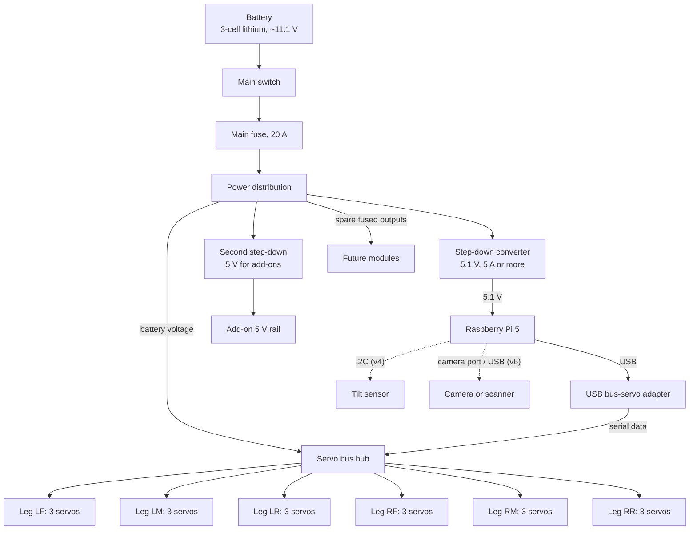

# 09 — Electronics and power

Wiring, power budget and electrical safety. Nothing here is bought before
version 2. Values marked **(estimate)** are replaced by measurements as hardware
arrives.

## Block diagram

## The computer

| Item | Detail |
|---|---|
| Board | Raspberry Pi 5 |
| Cooling | Active cooler. The Pi 5 throttles under sustained load without one |
| Storage | A fast microSD card to start; an NVMe drive on the PCIe connector is an optional upgrade |
| Network | Built-in Wi-Fi for normal use; Ethernet on the bench |
| Clock | A small battery on the Pi's clock connector keeps time without a network |

### Ports and what they are reserved for

| Port | Use |
|---|---|
| USB 3 (×2) | Servo bus adapter; one free for a scanner or camera |
| USB 2 (×2) | Gamepad receiver; one free |
| Camera/display connectors (×2) | Camera in version 6; one free |
| 40-pin header: I2C | Tilt sensor (version 4); other I2C sensors |
| 40-pin header: serial | Free; alternative path to the servo bus |
| 40-pin header: general pins | Foot switches (version 5), status light, button |
| PCIe connector | Optional NVMe drive or AI accelerator |

## Powering the Pi 5 from a battery

The Pi 5 is more demanding than earlier models.

- It is designed for a 5 V supply that can deliver 5 A. With a 3 A supply it runs,
  but limits the current available to its USB ports.
- On the robot it is fed by a step-down converter from the battery. The converter
  must be rated comfortably above 5 A continuous, and set slightly above 5 V
  (about 5.1 V) to allow for cable loss.
- A plain converter cannot tell the Pi how much current it can supply, as the
  official power supply does. The Pi is told through its configuration that a 5 A
  supply is present. The exact settings are taken from the Raspberry Pi
  documentation when the hardware is wired.
- Small, cheap converter modules often cannot sustain their advertised current.
  Choose one advertised well above 5 A, and test it under load before trusting it.

On the bench, the official 27 W supply powers the Pi and a separate bench supply
powers the servos.

## The servo bus

| Aspect | Detail |
|---|---|
| Type | Serial bus servos: every servo shares one data line and has its own address |
| Signal | Single-wire, half-duplex serial at up to 1 Mbit/s |
| Addresses | 1 to 18, see [05 — Software stack](05-software-stack.md) |
| Connection to the Pi | A small USB adapter board made for these servos |
| Feedback available | Position, speed, load, input voltage, current, temperature |
| Topology | Adapter → hub → six chains of three servos, one chain per leg |

### Why one chain per leg

Bus servos are designed to be daisy-chained, and the data line could run through
all 18. The power line could not: the thin servo cable would carry the whole
robot's current and the voltage would sag at the far end. Each leg's chain is
therefore powered separately from the hub, and the hub is fed by heavier wire from
the power distribution.

### Timing

Each control cycle writes 18 targets and reads back 18 states. Group read and write
commands keep this to a few messages. The expected achievable rate is 50 to 100
cycles per second **(estimate)**; it is measured in version 2 and decides the
control rate.

## Power budget

Assuming the 12 V candidate servo. All servo currents are estimates until measured.

| Consumer | Typical | Peak | Notes |
|---|---|---|---|
| 18 servos, walking | 7 A (about 0.4 A each) | 15 A | Stall current is 2.7 A each; all 18 stalling at once is not a design case, the fuse covers it |
| Raspberry Pi 5 | 0.5–1 A at battery voltage | 2.3 A | 5–12 W typical, up to 25 W with peripherals, plus converter loss |
| Add-on rail | 0 | 1 A | Reserved |
| **Total** | **about 8 A (95 W)** | **about 18 A** | |

### Battery

| Item | Choice | Reason |
|---|---|---|
| Chemistry | Lithium polymer, 3 cells in series | 11.1 V nominal suits 12 V servos; high current capability |
| Capacity | 4000–5000 mAh | 44–55 Wh |
| Discharge rating | 25C or higher | Far more than needed; common and inexpensive |
| Connector | XT60 | Rated well above the peak current |
| Expected running time | 20–30 minutes of continuous walking | 80% of capacity at about 95 W **(estimate)** |

A 3-cell pack is 12.6 V when full. That is above the servo's 12 V nominal rating.
The servo's maximum input voltage is checked against its datasheet before the
first battery run; if 12.6 V is outside it, the servos are fed through a regulator
instead. This is risk R7 in
[15 — Risks and open questions](15-risks-and-open-questions.md).

### Battery monitoring

The servos report their input voltage, so the battery is monitored through the bus
with no extra sensor.

| Level | Voltage (3 cells) | Action |
|---|---|---|
| Normal | Above 10.8 V | |
| Warning | 10.5 V (3.5 V per cell) | Publish a warning |
| Critical | 9.9 V (3.3 V per cell) | Controlled sit-down, torque off |

The battery is never left connected when the robot is off.

## Wiring

| Run | Wire | Notes |
|---|---|---|
| Battery to switch, fuse, distribution | 14 AWG silicone | Carries the full current |
| Distribution to servo hub | 16 AWG | |
| Hub to each leg chain | 20 AWG | Up to about 8 A if all three servos stall |
| Within a leg | The servo's own cables | |
| Distribution to step-down converters | 18–20 AWG | |
| Converter to Pi | Short, 18–20 AWG | Long thin leads cause voltage drop and brown-outs |

- Common ground: all grounds meet at the power distribution.
- A large capacitor at the servo hub absorbs current spikes.
- Servo power and Pi power separate at the distribution point, so servo spikes do
  not pull down the Pi's supply.

## Safety

| Hazard | Protection |
|---|---|
| Short circuit | Main fuse close to the battery; spare outputs individually fused |
| Runaway robot | Main switch within reach; `relax` command; command timeout |
| Servo overload or overheating | The servo's built-in protection, plus driver checks that relax the leg |
| Deep-discharged battery | Voltage monitoring with a forced sit-down; a plug-in cell alarm as an independent backup |
| Lithium battery fire | Charge only with a balance charger, attended, in a fire-resistant bag; never charge a damaged or swollen pack |
| Pinched fingers | The robot is on a stand, feet off the ground, for every first test of new motion |
| Reverse polarity | Keyed connectors everywhere |

## Bench setup for version 2

| Item | Purpose |
|---|---|
| 12 V bench supply with a current limit | Powers the servos safely; the current limit protects against wiring mistakes |
| Official Pi 5 power supply | Powers the Pi |
| USB bus-servo adapter | Connects the Pi or the PC to the servos |
| Multimeter | Checks before every first power-up |
| Leg stand | Holds the single leg clear of the bench |

The same adapter also lets the PC talk to the servos directly, which is useful for
setting addresses and for the measurement work in step 2.6.

## Growth

| Version | Electrical addition |
|---|---|
| 4 | Tilt sensor on I2C |
| 5 | Six foot switches on general pins, if load sensing is not enough |
| 6 | Camera on a camera connector, or a scanner on USB with 5 V from the add-on rail |
| Later | Speaker, microphone, lights; an AI accelerator on the PCIe connector |

A custom circuit board replacing the hub and distribution wiring is a possible
later tidy-up, once the layout has stopped changing.

## References

| Source | Used here for | Checked |
|---|---|---|
| [Raspberry Pi documentation](https://www.raspberrypi.com/documentation/computers/raspberry-pi.html) | Pi 5 power requirements and supply configuration | — |
| [Powering a Raspberry Pi 5, Pololu forum](https://forum.pololu.com/t/powering-a-raspberry-pi-5/26012) | Powering a Pi 5 from a step-down converter; converter current ratings | 2026-11-13 |
| [Raspberry Pi 5 power FAQ, element14](https://community.element14.com/products/raspberry-pi/f/raspberry-pi-5-faq/53749/what-power-supply-do-i-need-for-the-raspberry-pi-5-can-i-use-a-previous-power-supply-and-does-it-support-usb-pd) | USB current limits with 3 A and 5 A supplies | 2026-11-13 |
| [Feetech STS3215, Switch Science](https://www.switch-science.com/products/7489) | Servo bus signalling, speed and feedback values | 2026-11-13 |
| [Feetech STS3215, Core Electronics](https://core-electronics.com.au/feetech-sts3215-smart-servo.html) | Servo stall current, used in the power budget | 2026-11-13 |
| [Feetech STS3215, AIFITLAB](https://aifitlab.com/collections/servo-motor/products/feetech-sts3215-servo-motor) | 12 V version stall current (2.7 A) | 2026-11-13 |

The full list for the project is in [References](references.md). A dash means the source
is listed for reference and was not re-read on a specific date.
