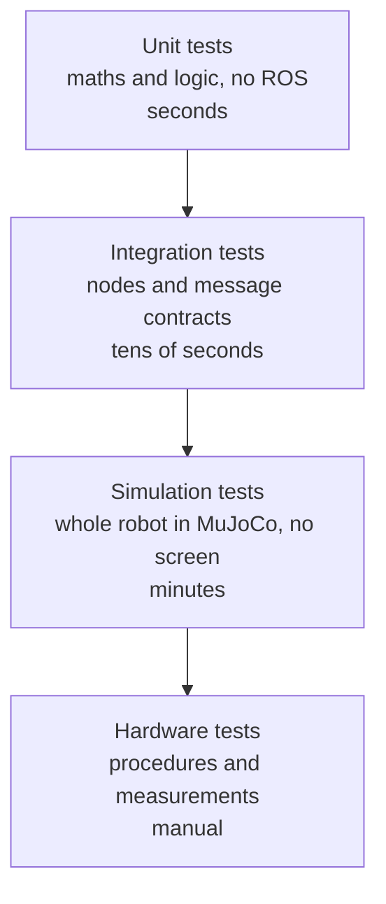

# 14 — Testing and validation

How each layer is checked, and how the simulation is compared with the real robot.

## Principles

1. **Test the maths without the robot.** Geometry and gait logic are pure functions
   and are tested directly, in milliseconds.
2. **Test behaviour in simulation, automatically.** Each version's exit test is a
   script that runs without a screen.
3. **Test hardware with checklists and measurements.** What cannot be automated is
   written down as a procedure with pass criteria.
4. **A test is written before the thing it tests.**
5. **A failure found on the robot becomes a simulated test** where possible, so it
   cannot return unnoticed.

## Levels

### Unit tests

| Subject | Examples |
|---|---|
| Forward and inverse kinematics | Inverse then forward returns the starting point for thousands of random reachable targets; known poses give known angles |
| Reach and limit handling | Every kind of unreachable target is reported, never silently wrong |
| Body transform | Raising the body by 10 mm lowers every foot target by 10 mm in the body frame |
| Gait timing | In tripod gait exactly three feet are in stance at all times; phases wrap correctly |
| Foot paths | Stance path is a straight line of the right length; swing clears the step height; paths join without a jump |
| Stride scaling | An over-long stride is scaled for all legs together |
| Stability margin | Known foot layouts give known margins |
| Parameter file | Loads, validates ranges, converts units |

Tool: pytest. Property-based tests generate the random cases.

### Integration tests

| Subject | Examples |
|---|---|
| Walker node | A velocity command in produces 18 joint targets out, at the right rate, in the right order |
| Command timeout | Stopping the commands stops the walking |
| Launch | The launch file starts every expected node, in both modes |
| Contracts | Each topic in [05 — Software stack](05-software-stack.md) carries the documented type |

Tool: launch_testing.

### Simulation tests

Each roadmap exit test that can be simulated is a script. Examples from version 1:

| Test | Pass criterion |
|---|---|
| Straight walk, 2 m | Sideways drift under 10% |
| Turn in place, 360° | Ends within 50 mm of the start |
| Body pose while walking | No foot slips more than 5 mm |
| Gait switching | No fall, no joint limit hit |
| Long run, 5 minutes | No drift into instability; no error messages |
| Limits | No joint exceeds its range; no torque exceeds the limit |

Every simulation test also records the measurements listed under the torque report
in [06 — Simulation](06-simulation.md), so trends are visible across changes.

### Hardware tests

| Stage | Procedure | Pass criterion |
|---|---|---|
| Before first power | Continuity and polarity check with a multimeter | No shorts; correct polarity at every connector |
| Single servo | Address set; moves to commanded angles; feedback readable | Angle error under 1° |
| Bus timing | Read and write all servos in a loop | Meets the control rate |
| One leg | Foot traces the 60 mm square | Error under 8 mm |
| Protection | Block a joint by hand | Overload detected; leg relaxes |
| Calibration | Neutral stance commanded; foot positions measured | Within 5 mm of the model |
| Power | Run on battery at full walking load | Pi does not brown out; wiring stays cool |
| Low battery | Lower the bench supply voltage | Warning, then sit-down, at the set voltages |
| Endurance | 15 minutes of walking | No servo over its temperature limit |

## Comparing simulation and reality

The same command sequence is run on both, recorded, and overlaid.

| Comparison | When | Acceptable difference |
|---|---|---|
| Single joint step response | Version 2 | Rise time within 10% |
| Foot path of one leg | Version 2 | Within 5 mm |
| Walking speed for a given command | Version 3 | Within 15% |
| Drift over 2 m | Version 3 | Same direction, same order of size |
| Power draw while walking | Version 3 | Within 25% |
| Body tilt on a slope | Version 4 | Within 2° |

When a difference is outside its limit, the model is corrected. The code is not
tuned separately for each world.

## Recorded data

| What | How |
|---|---|
| Every simulated and real test run | Recorded with `ros2 bag` |
| Torque and stability reports | Generated by a script, saved with the version tag |
| Comparison plots | Generated by a script from two recordings |

Large recordings are kept out of git; the scripts and the summary reports are in.

## Definition of done for a version

- [ ] Every exit test in the roadmap passes.
- [ ] All automated checks pass on the main branch.
- [ ] New behaviour has simulated tests.
- [ ] Documents affected by the version are updated.
- [ ] Estimates replaced by measurements are marked as measured.
- [ ] Decision records exist for the significant choices made.
- [ ] The version is tagged.

## References

No external sources. This document draws only on the owner's decisions and the
other documents in this repository. The project's full list is in
[References](references.md).
